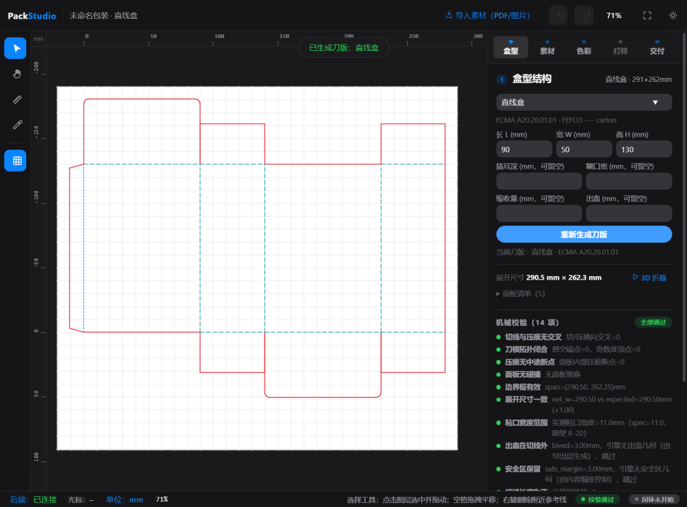
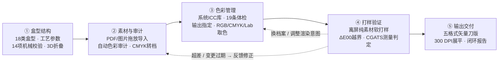

<div align="center">

# PackStudio

**一体化包装印前工作台 · 参数化刀版引擎 × ICC 色彩闭环工作流**

[](https://github.com/11122313211/PackStudio/actions/workflows/ci.yml)
[](pyproject.toml)
[](frontend/package.json)
[](frontend/package.json)
[](frontend/vite.config.ts)
[](#测试与质量保障)
[](LICENSE)

</div>

---

**PackStudio** 将 **参数化刀版引擎（packaging_engine）** 与 **专业 ICC 色彩管理引擎（color_engine）** 融为统一的本地印前桌面工作台：提供 Photoshop 式三区工作空间、**五阶段色彩闭环工作流**（软门控 + 渐进式披露 + 过期联动）与 **iOS 扁平磨砂玻璃深浅双主题**，全部在本地 `127.0.0.1` 离线安全运行。

<p align="center">
  
</p>

## 五阶段色彩闭环工作流



| 阶段 | 核心能力 |
|---|---|
| **① 盒型结构** | 内置 **18 类参数化盒型**（共 19 项注册，含 ECMA / FEFCO 标识），支持长宽高与插耳深/糊口宽/缩收量/出血工艺参数确定性生成刀版、展开尺寸引擎真值、**14 项机械校验**（含川崎/前泽折叠判定）及离线 Three.js 3D 折叠预览 |
| **② 素材与审计** | 支持点击或画布拖放导入 PDF（逐页高分渲染 + **自动执行印前色彩审计**：OutputIntent / 内嵌 ICC / 专色 / 未管理色空间）与位图；图层居中落位、旋转命中与吸附、批量撤销；逐图层 ICC 赋档/嵌档/转换（CMYK 自动输出无损 TIFF 并附画布 sRGB 预览） |
| **③ 色彩管理** | 自动扫描系统 ICC 档案库（支持搜索、设备类筛选、强制刷新）与 **19 条结构规则体检**；指定输出设备档案、渲染意图、黑点补偿（BPC）与色差口径；离屏纯素材吸管取色，实时显示 `sRGB → CMYK（含总墨量 TAC%）→ L*a*b*` |
| **④ 打样验证** | 独立世界坐标离屏渲染纯素材进行往返软打样（**不受缩放/平移裁切，不含刀线与网格干扰**），默认采用与 ISO 12647-2 对齐的 **`ΔE00`（CIEDE2000）** 越界掩图与统计（兼容 `ΔE76`）；支持上传分光光度计 CGATS.17 文件对标 Fogra39 判定；素材/参数变动自动标记过期 |
| **⑤ 输出交付** | 导出 **SVG / DXF (R12) / PDF / 专色分色 PDF（Cut/Valley/Mountain/Bleed）/ CF2** 五种矢量刀版；按真实目标 DPI（96 / 150 / 300）离屏高清展平 PNG（可选含/不含刀版）；汇总输出全流程色彩闭环报告 |

## 支持的盒型一览（18 类参数化已实现）

| 族别 | 盒型名称 |
|---|---|
| **常规彩盒（Carton）** | 直线盒 (`A20.20.01.01`)、锁底盒 (`A01.55.00.01`)、飞机盒、上盖盒、同向盖 (`A20.20.03.01`)、粘底盒、挂耳盒、手提盒、插口锁底盒 (`A01.55.00.01`)、屋顶提手盒 (`FEFCO 0217`)、枕式盒、翻盖食品盒、卷边托盘锁扣盒 (`FEFCO 0427`)、菱形折面盒 |
| **运输箱（Shipping）** | 纸箱 (`FEFCO 0201`) |
| **托盘与套筒（Tray / Sleeve）** | 托盘盒、套筒托盘、四壁托盘带角扣 |

> 注：屋顶提手盒（`gable_top`）屋面为展示级近似结构，批量制版前需结合印厂工艺复核（`DESIGN_TEMPLATE + REQUIRES_MANUFACTURER_REVIEW`）。

## 快速开始

### 环境要求

- **Python** `>= 3.12`
- **Node.js** `>= 20`（用于前端开发或重新构建）

### Windows 一键启动

```bat
scripts\启动工作台.bat           :: 自动校验/重建 .venv + 按需构建前端 + 启动 :8001 并打开浏览器
scripts\启动工作台.bat --build   :: 强制重新构建前端后启动
```

### 手动安装与运行（跨平台）

```bash
# 1. 创建虚拟环境并安装后端依赖
python -m venv .venv
# Windows:
.venv\Scripts\python.exe -m pip install -e ".[dev]"
# macOS / Linux:
.venv/bin/python -m pip install -e ".[dev]"

# 2. 构建前端生产产物
cd frontend && npm install && npm run build && cd ..

# 3. 启动工作台（默认监听 http://127.0.0.1:8001）
python -m packstudio.app
```

### 开发模式（前后端热更新）

```bash
# 终端 1：后端 Flask API (:8001)
python -m packstudio.app

# 终端 2：前端 Vite Dev Server (:5173，/api 自动代理到 :8001)
cd frontend && npm run dev
```

## 项目架构

```text
PackStudio/
├── backend/
│   ├── packstudio/
│   │   ├── app.py                     # Flask 应用工厂（统一响应协议、本机 Origin CSRF 防护、127.0.0.1 绑定）
│   │   ├── api/                       # boxes / dieline / icc / pdf / export 五大蓝图 + 临时文件 TTL 自动清理
│   │   └── engines/
│   │       ├── packaging_engine/      # 参数化刀版引擎（几何生成 / 14 项机械校验 / 3D 折叠 / 五格式导出 / BOM）
│   │       └── color_engine/          # ICC 色彩引擎（头部与 Tag 校验 / CMM 变换 / 图像流水线 / PDF 审计 / CGATS ΔE00）
│   └── tests/                         # 704+ 后端单元测试、回归测试与 API 集成测试
├── frontend/                          # React 18 + TypeScript + Vite 6 + Zustand + Vitest（零第三方 UI 库）
│   └── src/
│       ├── editor/                    # 框架无关的画布引擎（视口/旋转命中/按需离屏渲染/SVG 解析/PDF 导入）
│       ├── flow/                      # 五阶段软门控状态推导与步进器
│       ├── stages/                    # 五阶段业务面板组件
│       ├── layout/                    # 顶栏 / 工具列 / 中央画布与标尺 / 状态栏（断线自动重连）
│       ├── store/                     # Zustand 全局状态、历史撤销栈与过期联动
│       └── styles/                    # iOS 扁平磨砂玻璃深浅双主题 Token
├── docs/
│   ├── DESIGN.md                      # 信息架构、色彩闭环契约与 iOS 视觉设计规范
│   └── assets/                        # 文档与工作台实景截图
├── .github/                           # GitHub Actions CI 工作流、Issue/PR 模板
└── scripts/启动工作台.bat              # Windows 智能一键启动脚本
```

## REST API 速查

所有接口遵循统一响应信封 `{"ok": true, "data": ...}` / `{"ok": false, "error": {"code": "...", "message": "...", "detail": {...}}}`：

| 方法与路径 | 说明 |
|---|---|
| `GET /api/health` | 服务健康检查与版本信息 |
| `GET /api/boxes` | 获取 19 项盒型目录、ECMA/FEFCO 编号与实现状态 |
| `POST /api/dieline` | 按盒型与尺寸/工艺参数生成 y-down 刀版 SVG、面板清单与 14 项机械校验 |
| `GET /api/dieline/fold` | 生成离线 3D 折叠预览 HTML（支持透传可选工艺参数） |
| `POST /api/pdf/audit` | PDF 印前色彩审计（OutputIntent / 逐页色空间 / 专色 / 内嵌档案） |
| `GET /api/icc/profiles` | 扫描系统 ICC 档案库（支持 `?refresh=1` 强制重扫） |
| `GET / POST /api/icc/validate` | 按 19 条结构规则体检系统或上传的 ICC 档案 |
| `POST /api/icc/convert` | 图像 ICC 赋档/嵌档/剥离/转换（CMYK 自动输出 TIFF 并附 sRGB 预览） |
| `POST /api/icc/lab` | 像素取色换算（`sRGB → 设备空间 CMYK/RGB/Gray → CIELAB` + 总墨量 TAC%） |
| `POST /api/icc/proof` | 离屏素材往返软打样 + `ΔE00`（兼容 `ΔE76`）越界掩图与统计 |
| `POST /api/icc/verify` | CGATS.17 实测文件 ΔE00 统计与 ISO 12647-2 / Fogra39 判定 |
| `POST /api/export` & `GET /api/download/<id>/<name>` | 五格式矢量刀版导出与白名单安全下载 |

## 安全设计与工程约束

- **本地最小暴露**：仅绑定 `127.0.0.1:8001`，不对外暴露端口；变更类请求校验本机 `Origin` 防御跨站写请求（CSRF）。
- **路径与输入防护**：上传体积限制 64 MB；下载严格按正则 ID + 安全文件名防路径穿越；ICC 路径校验系统目录白名单与合法后缀；SVG 解析拒绝 `DOCTYPE` / `ENTITY` 防 XXE。
- **磁盘生命周期管理**：临时上传与导出生成物均内置 6 小时 TTL 自动清理机制，防止长期运行堆积垃圾文件。

## 测试与质量保障

仓库已配置 [GitHub Actions CI](.github/workflows/ci.yml)，在每次 push 与 PR 时自动运行前后端全量检查：

```bash
# 后端全量测试（704 passed, 330 subtests passed）
pytest backend/tests -q

# 前端类型检查、Vitest 单元测试与生产构建
cd frontend
npm run typecheck
npm test
npm run build
```

## 路线图（Roadmap）

- [x] 参数化 18 类盒型刀版生成、14 项机械校验与离线 3D 折叠
- [x] 五阶段色彩闭环工作流与 iOS 扁平磨砂玻璃双主题 UI
- [x] 离屏高清渲染、CMYK 取色/转档闭环、状态过期联动与安全加固
- [ ] 工程文件 `.packstudio.json` 保存/恢复与浏览器草稿自动暂存
- [ ] 一键打包印前交付包（ZIP：多格式刀版 + CMYK TIFF + 闭环签核报告）
- [ ] 接入内置 CIE xy / Lab 色域可视化与 BOM 印厂审校面板

## 参与贡献与许可

欢迎提交 Issue 或 Pull Request！详见 [CONTRIBUTING.md](CONTRIBUTING.md) 与 [CHANGELOG.md](CHANGELOG.md)。

本项目基于 [MIT License](LICENSE) 开源发布。
